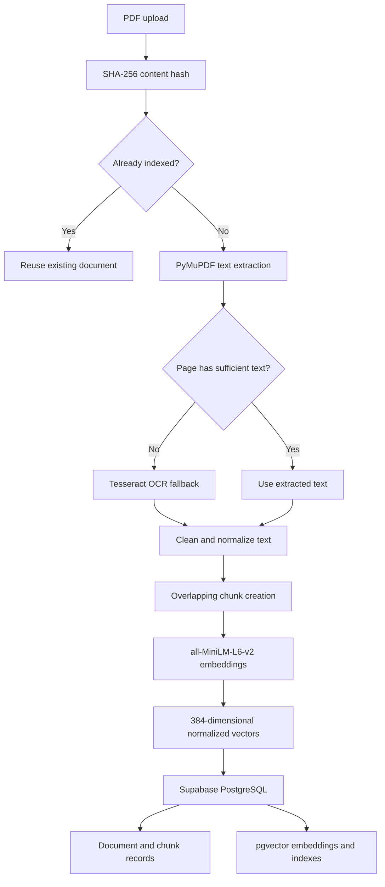
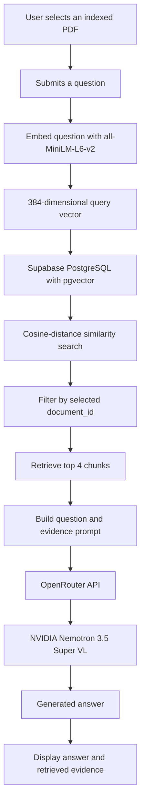
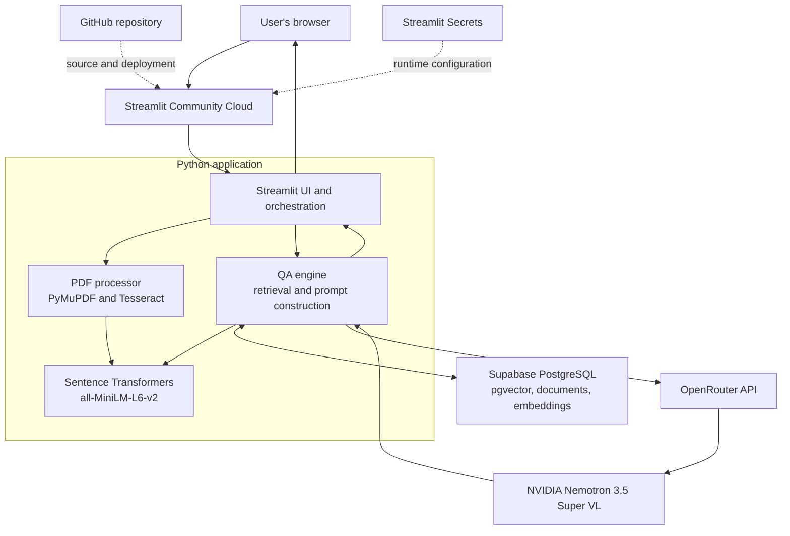

# PDF Q&A System

A cloud-deployed PDF question-answering application built around a retrieval-augmented generation (RAG) pipeline. It ingests PDF documents, extracts text with OCR fallback, creates dense vector embeddings, stores document chunks in Supabase PostgreSQL with pgvector, and generates evidence-grounded answers through the OpenRouter API.

The application is designed to make the complete PDF-to-RAG workflow explicit: document ingestion, vector indexing, document-scoped retrieval, and LLM-based answer generation.

## Live deployment

| Component | Platform | Responsibility |
| --- | --- | --- |
| Application and UI | Streamlit Community Cloud | Hosts the Streamlit application and runs the Python workflow |
| Database | Supabase | Hosts PostgreSQL and the pgvector extension |
| LLM inference | OpenRouter | Provides the chat-completion API endpoint |
| Source code | GitHub | Stores the application code and deployment source |

The deployed Streamlit application connects to Supabase for persistent document and vector storage, and to OpenRouter for answer generation. The embedding model runs inside the application process. It is not hosted as a separate inference service.

## Core capabilities

- **PDF ingestion:** Accepts PDF uploads and extracts text page by page using PyMuPDF.
- **OCR fallback:** Uses Tesseract on pages where selectable text extraction returns very little text.
- **Text cleaning and chunking:** Normalizes extracted text and splits it into overlapping, whitespace-aware character chunks.
- **Dense embeddings:** Uses Sentence Transformers with `all-MiniLM-L6-v2` to generate normalized 384-dimensional vectors.
- **Persistent vector storage:** Stores document metadata, extracted content, chunks, and embeddings in PostgreSQL using pgvector.
- **Document-scoped retrieval:** Restricts similarity search to the selected document through its `document_id`.
- **Approximate nearest-neighbour search:** Uses a pgvector HNSW index with cosine distance.
- **Grounded answer generation:** Sends the user's question and retrieved passages to NVIDIA Nemotron 3.5 Super VL through OpenRouter.
- **Source references:** Includes source labels in the generation context and displays the retrieved chunks alongside the answer.
- **Duplicate detection:** Uses SHA-256 hashes of uploaded PDF bytes to avoid indexing identical files repeatedly.
- **Caching:** Reuses the loaded embedding model and caches up to 256 query embeddings per QA engine instance.
- **Non-destructive database initialization:** Creates missing tables and indexes and applies additive schema changes without dropping existing document or embedding data.

## RAG pipeline

The ingestion and question-answering paths are separate stages of the RAG workflow.

### 1. Document ingestion and indexing



### 2. Question answering and retrieval



Retrieval uses pgvector's cosine-distance operator (`<=>`). Lower distance indicates greater similarity. The current application retrieves the top 4 chunks and constrains the search to the selected PDF. The LLM is instructed to answer from the supplied excerpts, treat document text as untrusted input, cite source labels, and state when the excerpts do not provide sufficient evidence.

## System architecture

This diagram shows the deployed components and their responsibilities. The embedding model runs within the Streamlit application environment; PostgreSQL and LLM inference are external managed services.



## Technology stack

| Layer | Technology | Usage |
| --- | --- | --- |
| UI and application runtime | Streamlit | User interface, upload flow, question submission, and orchestration |
| PDF parsing | PyMuPDF | Page-level text extraction |
| OCR | Tesseract, pytesseract, Pillow | Image-to-text fallback for scanned or image-based pages |
| Text embeddings | Sentence Transformers | Loads `all-MiniLM-L6-v2` for document and query embeddings |
| Vector dimensions | 384 | Embedding size stored in pgvector |
| Database | PostgreSQL on Supabase | Persistent document and embedding storage |
| Vector search | pgvector | Vector type, cosine-distance search, and HNSW indexing |
| Database driver | psycopg2 | Python to PostgreSQL connectivity |
| LLM API client | OpenAI Python SDK | OpenAI-compatible client configured for OpenRouter |
| LLM provider and model | OpenRouter, NVIDIA Nemotron 3.5 Super VL | Answer generation using `nvidia/nemotron-3.5-super-vl:free` |
| Configuration | python-dotenv, Streamlit Secrets | Local and hosted runtime configuration |
| Version control | Git and GitHub | Source control and deployment source |

## Database design

The application uses two primary tables.

### `documents`

| Column | Description |
| --- | --- |
| `id` | Primary key for the uploaded document |
| `filename` | Original uploaded filename |
| `content` | Extracted document text |
| `content_hash` | SHA-256 hash used for duplicate detection |
| `created_at` | Document creation timestamp |

### `embeddings`

| Column | Description |
| --- | --- |
| `id` | Primary key for the stored chunk |
| `document_id` | Foreign key referencing `documents.id` |
| `embedding` | 384-dimensional pgvector value |
| `text_chunk` | Text represented by the embedding |
| `chunk_index` | Position of the chunk within the document |

The relationship is one document to many chunks. The foreign key uses `ON DELETE CASCADE`, so deleting a document record also deletes its associated embeddings.

### Indexes and retrieval

- A partial unique index on `documents.content_hash` prevents duplicate non-null content hashes.
- A B-tree index on `embeddings.document_id` supports document filtering.
- An HNSW index using `vector_cosine_ops` supports approximate cosine-distance search.

The application creates the pgvector extension and required schema objects during database initialization. Existing records are retained; initialization does not reset the database.

## Repository structure

| Path | Responsibility |
| --- | --- |
| `app/main.py` | Streamlit interface, upload handling, document selection, and workflow orchestration |
| `app/pdf_processor.py` | PDF extraction, OCR fallback, text cleaning, chunking, and embedding generation |
| `app/qa_engine.py` | Query embedding cache, vector retrieval coordination, prompt construction, and LLM generation |
| `app/database.py` | PostgreSQL connection, schema initialization, document persistence, duplicate lookup, and vector search |
| `app/config.py` | Loads configuration from environment variables or Streamlit Secrets |
| `requirements.txt` | Python dependencies |
| `packages.txt` | System packages installed by Streamlit Cloud, including Tesseract OCR |
| `.env.example` | Safe configuration template containing placeholders |
| `.gitignore` | Excludes local secrets, virtual environments, and generated files |

## Local development

### Prerequisites

- Python 3.10 or newer.
- A PostgreSQL database with pgvector available, or a Supabase PostgreSQL project.
- An OpenRouter API key with access to the configured model.
- Tesseract installed locally if OCR is enabled.

### 1. Clone the repository

```bash
git clone https://github.com/Lemniscate-2525/PDF_QnA_System.git
cd PDF_QnA_System
```

### 2. Create a virtual environment

**Windows PowerShell**

```powershell
python -m venv .venv
& "$PWD/.venv/Scripts/Activate.ps1"
```

**macOS or Linux**

```bash
python3 -m venv .venv
source .venv/bin/activate
```

### 3. Install dependencies

```bash
pip install -r requirements.txt
```

Install the Tesseract OCR executable separately if OCR is required. Installing `pytesseract` through pip does not install the Tesseract engine itself.

### 4. Configure environment variables

Copy the example configuration:

**Windows PowerShell**

```powershell
Copy-Item .env.example .env
```

**macOS or Linux**

```bash
cp .env.example .env
```

Configure the database and OpenRouter credentials in `.env`:

```dotenv
DB_HOST=your_supabase_pooler_host
DB_PORT=5432
DB_NAME=postgres
DB_USER=your_supabase_database_user
DB_PASSWORD=your_database_password

OPENROUTER_API_KEY=your_openrouter_api_key
OPENROUTER_MODEL=nvidia/nemotron-3.5-super-vl:free

OCR_ENABLED=true
OCR_LANGUAGES=eng
```

Use the connection details provided by your Supabase project. If the database password contains special characters and you use a URI connection string, URL-encode those characters. When using the separate variables above, provide the actual password value.

Never commit `.env`, database passwords, or API keys.

### 5. Run the application

From the repository root:

```bash
python -m streamlit run app/main.py
```

Open the local URL printed by Streamlit, upload a PDF, select **Process PDF**, choose the indexed document, and submit a question.

## Cloud deployment configuration

### Streamlit Community Cloud

The Streamlit application is deployed from this GitHub repository. Streamlit Cloud installs the Python dependencies from `requirements.txt` and the system dependency from `packages.txt`.

Configure the following values in the app's Streamlit Secrets settings:

```toml
DB_HOST = "your_supabase_pooler_host"
DB_PORT = "5432"
DB_NAME = "postgres"
DB_USER = "your_supabase_database_user"
DB_PASSWORD = "your_database_password"

OPENROUTER_API_KEY = "your_openrouter_api_key"
OPENROUTER_MODEL = "nvidia/nemotron-3.5-super-vl:free"

OCR_ENABLED = "true"
OCR_LANGUAGES = "eng"
```

The application configuration checks environment variables first and then Streamlit Secrets. Do not put production credentials in GitHub files.

### Supabase

Supabase hosts the PostgreSQL database. The application connects using the project's database connection details, with the configured pooler endpoint. The database contains the `documents` and `embeddings` tables and the pgvector extension.

### OpenRouter

OpenRouter provides the chat-completion endpoint. The application uses the OpenAI Python SDK with the OpenRouter-compatible base URL. The configured model is NVIDIA Nemotron 3.5 Super VL, using the free model identifier shown above. Free model availability, request limits, and throughput are controlled by the provider and may change.

## Implementation details

### Chunking

Text is split into character-based chunks with a default chunk size of 1,000 characters and an overlap of 150 characters. The chunker prefers sentence or whitespace boundaries where possible to avoid splitting text at arbitrary positions. Chunking is character-based, not tokenizer-based.

### Embedding generation

Both document chunks and user questions are embedded with the same `all-MiniLM-L6-v2` model. Embeddings are normalized and stored as 384-dimensional vectors. Using the same model for indexing and querying keeps both representations in the same vector space.

### Retrieval

The question embedding is compared against stored vectors using pgvector cosine distance. Retrieval is filtered by the selected document ID and returns up to four chunks. This prevents the current query from retrieving chunks belonging to a different selected PDF.

### Duplicate handling and caching

- The application calculates a SHA-256 hash from the original PDF bytes.
- If the same file has already been indexed, the existing document record is reused rather than creating duplicate chunks.
- The Sentence Transformer model is cached within the application process.
- Query embeddings are cached with an LRU cache of up to 256 entries per QA engine instance.

The hash detects identical file bytes. It does not identify semantically identical PDFs whose underlying bytes differ.

### Answer generation

The QA engine constructs a prompt containing the user's question and retrieved passages. The model is instructed to rely on the provided excerpts, treat their contents as untrusted data rather than instructions, cite source labels, and acknowledge insufficient evidence instead of guessing.

The displayed source passages allow users to inspect the evidence returned by retrieval. They do not guarantee that every generated claim is correct.

## Current scope and limitations

This is a deployed engineering project and a functional end-to-end RAG implementation. It is not yet a hardened multi-tenant production service.

- **Authentication and authorization:** User accounts and per-user document ownership controls are not implemented. Document-scoped retrieval is not a substitute for user-level authorization.
- **Rate limiting and abuse protection:** Application-level user quotas and request throttling are not implemented.
- **Background processing:** PDF extraction, OCR, and embedding generation run in the application workflow. There is no separate job queue or worker service.
- **Retrieval quality:** The current implementation uses dense vector retrieval. It does not include BM25 hybrid search, a reranker, query rewriting, or a formal retrieval evaluation dataset.
- **OCR accuracy:** Results depend on scan quality, page layout, language data, and image resolution. Complex tables, handwriting, and poor scans may extract incorrectly.
- **Chunking strategy:** Chunk sizes are character-based and may need tuning for different document types and query patterns.
- **LLM reliability:** Generated answers can contain errors even when relevant passages are retrieved. Always inspect the supporting excerpts for important decisions.
- **Provider limits:** OpenRouter free model availability and rate limits can change.
- **Resource limits:** Very large PDFs can consume substantial memory and processing time, particularly when OCR is required.
- **Document lifecycle:** A user-facing document deletion and management workflow is not currently included.

## Troubleshooting

| Issue | Checks |
| --- | --- |
| Database connection refused | Confirm that the Supabase host, port, database, username, and password are configured correctly. Do not use `localhost` for the hosted database. |
| Password authentication failed | Recheck the database password and the exact username shown by Supabase for the selected connection method. |
| pgvector extension error | Confirm the `vector` extension is available and enabled in the target database. |
| `No module named app` | Run Streamlit from the repository root and confirm the `app` package is present. |
| OpenRouter authentication or model error | Check the API key, model identifier, account status, and provider availability. |
| Tesseract not found | Install the Tesseract executable. On Streamlit Cloud, confirm `packages.txt` contains `tesseract-ocr`. |
| OCR language data error | Confirm the required Tesseract language data is installed and `OCR_LANGUAGES` matches it. |
| No relevant passages found | Check that the correct PDF is selected and try a more specific question. Consider chunk size, overlap, and retrieval depth when tuning quality. |

## Security

- Keep local `.env` files and production secrets out of version control.
- Use placeholders only in `.env.example`.
- Store hosted credentials in Streamlit Secrets.
- Do not expose Supabase database credentials or OpenRouter API keys in client-side code, logs, screenshots, or public commits.
- Only upload documents you are authorized to process.
- Document excerpts are sent to the configured external LLM provider for answer generation. Consider document sensitivity and provider data-handling terms before uploading confidential material.

## License

Add a license file if you intend to distribute this project for reuse. Until a license is added, the repository's source code is not automatically granted an open-source license.


## Productionization v2

The `productionization-v2` branch adds authenticated user workspaces, per-user document ownership and retrieval checks, Redis-backed sliding-window rate limiting and answer caching, hardened input handling, prompt-injection defenses, and an RQ-based background ingestion worker.

See [PRODUCTIONIZATION.md](PRODUCTIONIZATION.md) for the service architecture, required secrets, Supabase Storage setup, worker deployment, migration behavior, and two-user security verification checklist.

These changes are not active on the current production deployment until the branch is configured, tested, and merged/deployed.
